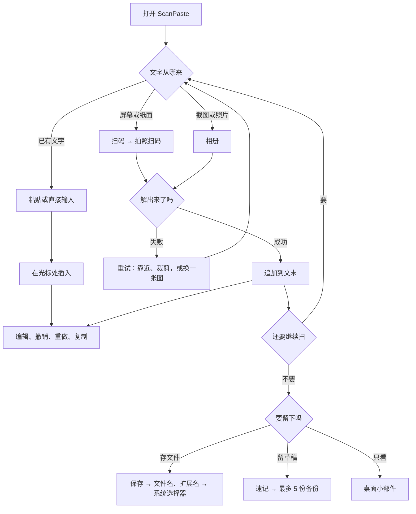

  

<h1 align="center">ScanPaste · 扫码笔记</h1>

扫一个二维码，文字直接落进你正在写的那篇笔记。

  <a href="README.md">English</a> · <b>简体中文</b>

  
  
  
  

## 能做什么

- **屏幕上的二维码，变成能改的文字。** 对着显示器、另一台手机或纸张扫一下，文字接到笔记末尾，光标停在后面。
- **扫截图。** 点「相册」选图。二维码只存在于图片里、手边又没有第二台手机时，这条最省事。只保留解出的文字，图片本身不进入笔记、不落盘。
- **几个二维码收进同一篇。** 连着扫，每段解出的文字按顺序接在后面，不用在应用之间来回复制粘贴。
- **在编辑区里改。** 选中、剪切、复制、粘贴都在同一篇里完成；撤销和重做最多 200 步，连续输入 500ms 内算一步；长笔记受历史内存预算限制，实际步数可能少于 200。
- **存成文件。** 自己填文件名和扩展名（`txt`、`md`、`csv`、`json`、`xml`、`html` 或别的都行）；文件按纯文本写出，扩展名只决定文件名与 MIME 类型，不做 JSON、XML、CSV 转换或校验。存到哪里由系统选择器决定。
- **下次打开还在。** 点「速记」存下当前内容，「速读」取回来；桌面小部件不开应用也能看上次保存的速记。注意「速读」会用速记替换编辑区（可撤销），冷启动也会自动载入并替换（不可撤销），两种情况都请先保存未保存的内容。
- **整篇复制。** 点「复制」，全文进剪贴板。

## 界面

  
  

左：编辑区与底部操作栏；右：保存时选择文件名与扩展名。

## 为什么用它

扫完一个二维码，文字常常就断了：系统相机只显示一次，关掉便没了。要把它放进文件，只能趁还在的时候粘走，或者照着敲一遍。笔记应用能编辑，却读不了二维码；剪贴板工具能把文字送到另一台设备，可它要联网、要账号，送完也不留东西。

ScanPaste 补的就是这一段：一个编辑框，一个扫码按钮。相机或截图读出来的文字，直接接进你正在写的那篇笔记，之后就是普通文本，能改、能撤销、能存成文件。

### 特点

- **扫码只追加，替换是另一回事。** 扫一次加一段文字，不会清掉已有内容；「速读」会用速记替换编辑区（可撤销），冷启动自动载入也会替换且不可撤销。
- **一屏就够。** 编辑区加一排按钮，没有文件夹、标签，也没有设置页。
- **撤销也管扫码。** 扫错了退一步就没了，扫码和打字用的是同一份历史。
- **离线是设计出来的。** 不申请 `INTERNET` 权限，就没有账号可登，也没有东西能被上传。
- **为小文本而设。** 典型二维码负载是几 KB；编辑器和导入能处理更大的文本（导入上限 1 MB），但它不是批量传输工具。

## 怎样用

这只是主流程，具体操作见下面的完整例子。

## 一个完整例子：三张截图并成一份 `items.txt`

1. **从空白开始。** 点「清空」，编辑区变空；如果原来的内容还有用，点「撤销」可以找回，或者先「保存」。
2. **读入第一张截图。** 点「相册」，选中图片。文字出现在文末，光标停在后面。
3. **读第二、第三张。** 重复第 2 步。每段解出的文字接在上一条后面，顺序就是读入顺序。
4. **顺序反了？** 点一次「撤销」，最后追加的那段文字消失，重新读。
5. **改一个错字。** 直接在光标处输入，改动同样可以撤销。
6. **存成文件。** 点「保存」，文件名填 `items`，扩展名填 `txt`，在选择器里选个位置（Android 8.0 及以上默认定位到 Documents）。提示「文件已保存」就是写好了。
7. **留个草稿。** 点「速记」。已有速记会先问是否覆盖；旧速记非空才占一份备份，最多 5 份，第一次保存没有备份。下次启动会自动载入并替换编辑区，未保存的内容请先保存。
8. **不开应用也能看。** 长按桌面添加 ScanPaste 小部件，速记内容显示在里面。
   小部件显示上次「速记」保存的内容，最多前 100 行，不是当前编辑区里的文字。

纸上的二维码，或者别人屏幕上的，从第 2 步起把「相册」换成「扫码」：相机打开，读到就自动返回并追加。

## 安装

从 [Releases](https://github.com/iFeel-is-a-mouse/ScanPaste/releases) 下载最新 APK，在 Android 7.0（API 24）及以上的手机上安装。浏览器或文件管理器可能要求你允许安装未知来源应用。

第一次点「扫码」时才会申请相机权限；「相册」不需要任何权限。

F-Droid 暂未收录。提交后被关闭，原因是 F-Droid 要求至少三个月的公开维护记录，之后会重新提交。构建配方在 [`fdroid/`](fdroid/)。

## 按钮速查

| 按钮 | 作用 |
|---|---|
| **扫码** | 打开相机，读到二维码后把文字追加到文末 |
| **相册** | 选一张图片，把图中二维码的文字追加到文末 |
| **撤销 / 重做** | 前后回退，最多 200 步；连续输入 500ms 内算一步 |
| **复制** | 整篇复制到剪贴板 |
| **清空** | 清空编辑区（可撤销） |
| **保存** | 通过系统选择器写出纯文本文件；扩展名只决定文件名与 MIME 类型 |
| **速记** | 存为速记；覆盖非空速记前最多留 5 份备份 |
| **速读** | 载入速记并替换编辑区（可撤销，先保存未保存的内容）；没有速记时导入文本文件 |

## 文件在哪

速记放在应用私有目录，不是公共的 Documents：

`Android/data/com.scanpaste.app/files/Documents/scanpaste/`

| 文件 | 用途 |
|---|---|
| `quicknote.txt` | 速记正文 |
| `quicknote-1.txt` … `quicknote-5.txt` | 覆盖非空速记前的备份（最多 5 份；首次保存没有备份） |

Android 11 及以上，其他应用读不到这个目录；Android 10 及更早，拿到存储权限的应用仍可能读到。

用「保存」导出的文件放在系统选择器里你选的位置。Android 8.0 及以上，选择器打开时定位到 Documents；Android 7.0 没有这个默认，选择器也可能忽略。卸载应用会删除速记和备份，已导出的文件不受影响。

## 隐私

- 没有 `INTERNET` 权限。
- 没有统计、广告、崩溃上报，也没有账号。
- 相机画面只在内存里读取，不保存。
- 相册里只读你选中的那一张，图片只在内存中解码，不写入磁盘。

## 已知限制

- 相册图片超过 20MB 时，提示是「未识别到二维码」，不会说明是图片太大。
- 摩尔纹很重时可能要多试一次，或者把二维码裁得更紧。
- 导入文本文件上限 1MB。
- 速记按设计放在应用私有目录，要分享请用「保存」。
- 小部件显示上次「速记」保存的内容（最多前 100 行），不是当前编辑区；没再点「速记」就一直显示旧内容。

## 从源码构建

需要 JDK 17+ 和 Android SDK Platform 35；在 `local.properties` 里设好 `sdk.dir`，运行 `./gradlew assembleDebug`。release 构建会读 `keystore.properties`，没有则产出未签名 APK。细节见 [CONTRIBUTING.md](CONTRIBUTING.md)。

## 版本

当前 **6.0**（versionCode 60）。

- **6.0**（2026-10-21）：速记与游戏数据移到应用私有目录，不再访问公共 Documents；游戏文案跟随界面语言。
- **5.9**：有摩尔纹、反光的截图更容易读出。
- **5.8**：长时间输入也能保留更多撤销步骤。
- **5.7**：支持全文撤销；启动时载入速记。

历史版本见 [Releases](https://github.com/iFeel-is-a-mouse/ScanPaste/releases)。

## 参与

欢迎提 issue 和 PR。有两条比风格更重要：保持离线；不要加 `INTERNET` 权限或任何网络依赖。流程见 [CONTRIBUTING.md](CONTRIBUTING.md)。

## 许可

MIT，见 [LICENSE](LICENSE)。Copyright (c) 2026 iFeel。

---

ScanPaste 不适合做什么、和扫码器、笔记应用、剪贴板工具有什么区别：[docs/positioning.md](docs/positioning.md)。
