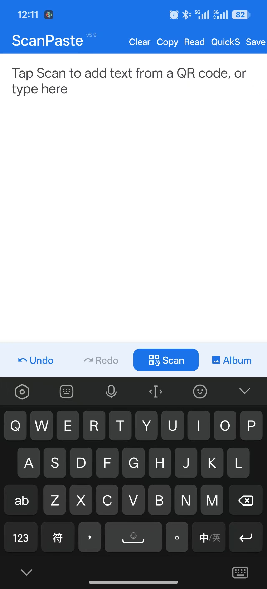
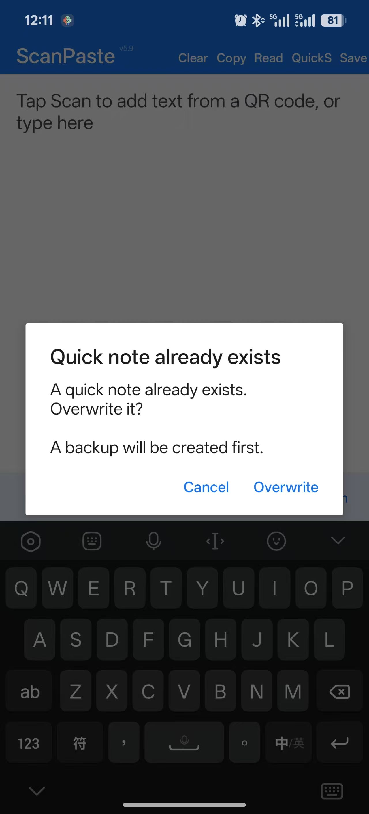
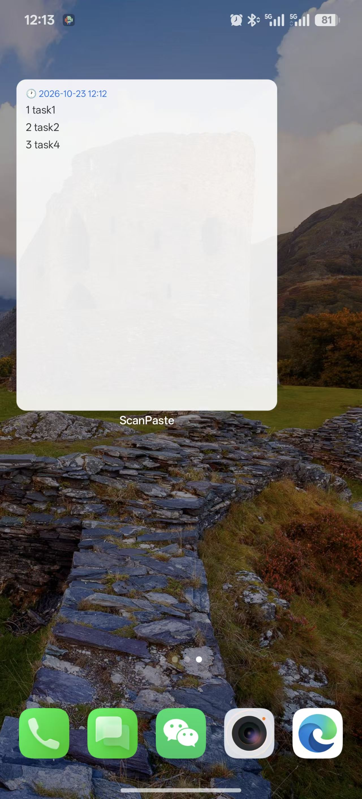
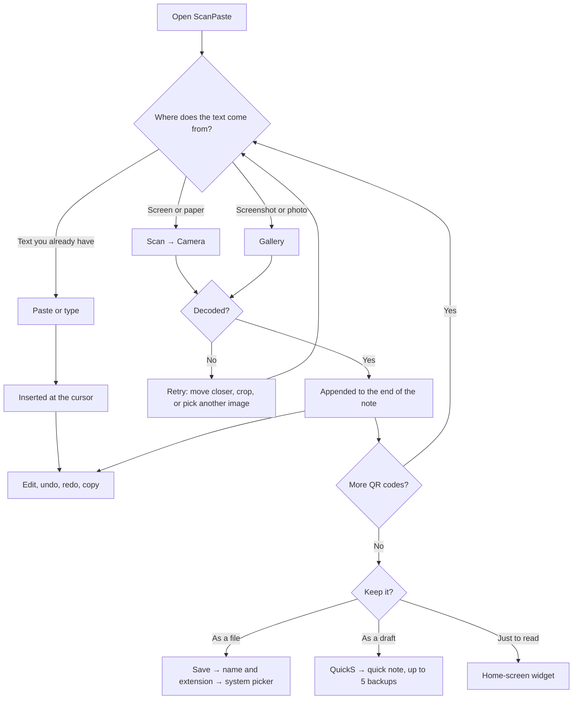

  

<h1 align="center">ScanPaste</h1>

Scan a QR code. The text lands in the note you are editing.

  <b>English</b> · <a href="README-cn.md">简体中文</a>

  
  
  
  

## What you can do

- **Turn a QR code on screen into text you can edit.** Point the camera at
  one on a monitor, another phone, or paper. The text is added to the end of
  the note, with the cursor after it.
- **Scan a screenshot.** Tap **Album** and pick the image. Useful when the QR
  code exists only as a picture and you have no second phone to hold up to it.
  Only the decoded text is kept; the image is not added to the note or written
  to disk.
- **Gather several QR codes in one place.** Scan one after another; each
  decoded text is appended below the last, in the order you scanned.
- **Retype only what is wrong.** Select, cut, copy, and paste inside the note.
  Undo and redo step back and forward up to 200 times. Typing within 500 ms
  counts as one step, and long notes may keep fewer than 200 steps because
  history shares a fixed memory budget.
- **Save it as a file.** Pick a name and an extension (`txt`, `md`, `csv`,
  `json`, `xml`, `html`, or one you type); the text is written as plain text.
  The extension only sets the file name and MIME type — no JSON, XML, or CSV
  conversion or validation. The system picker decides where it goes.
- **Keep a note between sessions.** **QuickS** stores the current text as the
  quick note, **Read** loads it back, and a home-screen widget shows the last
  saved note without opening the app. **Read** replaces the editor (undoable)
  and the note loads by itself at launch (not undoable); save unsaved text
  before either.
- **Copy the whole note** to the clipboard with one tap.

## Screenshots

  
  
  

Left: the editor and the bottom action bar; middle: confirming an overwrite of
the quick note; right: the home-screen widget showing the last saved note.

## Why this exists

A QR code is usually a dead end. The system camera reads it, shows the text
once, and the text is gone when you close it. If that text belongs in a file,
you either retype it or paste it somewhere before it disappears. Note apps edit
text well but cannot read QR codes. Clipboard tools move text between devices, yet
they need a network and an account, and nothing stays behind.

ScanPaste covers that one gap: a note with a scan button. The text the camera or
a screenshot yields is appended to the note you were already writing. From there
it is ordinary text — editable, undoable, saveable.

### Characteristics

- **Scans append; replacing is a separate action.** A scan adds to what you have
  and never wipes the note. **Read** replaces the editor with the quick note
  (undoable), and the automatic load at launch also replaces it, without an
  undo step.
- **One screen.** The editor and a row of buttons. No folders, tags, or
  settings page to work through.
- **Undo covers scans too.** A wrong QR code is one tap away from gone, because
  scans and typing share the same history.
- **Offline by design.** There is no `INTERNET` permission, so there is no
  account to sign in to and nothing that can be uploaded.
- **Built for small text.** A typical QR payload is a few KB. The editor and import
  handle larger text — import is capped at 1 MB — but this is not a bulk
  transfer tool.

## How it works

This is only the main flow; for step-by-step detail, see the worked example below.

## A worked example: three screenshots into one `items.txt`

1. **Start from an empty note.** Tap **Clear**. The editor goes blank; if it
   held something you still need, **Undo** brings it back, or **Save** it first.
2. **Scan the first screenshot.** Tap **Album**, pick the image. The text
   appears at the end of the note, with the cursor after it.
3. **Scan the second and third.** Repeat step 2. Each decoded text is
   appended below the previous one, in scan order.
4. **Scanned out of order?** Tap **Undo** once. The last appended text
   disappears; scan it again.
5. **Fix a character.** Type at the cursor. The change can be undone like any
   other edit.
6. **Save the file.** Tap **Save**, enter `items` as the name and `txt` as the
   extension, then pick a folder in the picker (Documents is where it opens on
   Android 8.0 and newer). "File saved" confirms it.
7. **Keep it as a draft.** Tap **QuickS**. If a quick note already exists, the
   app asks before overwriting and, when the old note is not empty, saves it to
   one of up to five backup slots. The note loads by itself on the next launch
   and replaces the editor then, so save unsaved text first.
8. **Check it without opening the app.** Long-press the home screen, add the
   ScanPaste widget. The last saved quick note shows there, up to 100 lines.

For a QR code on paper or on someone else's screen, start at step 2 with **Scan**
instead of **Album**: the camera opens, and the text is appended as soon as one is
read.

## Install

Download the latest APK from
[Releases](https://github.com/iFeel-is-a-mouse/ScanPaste/releases) and open it on
Android 7.0 (API 24) or newer. Your browser or file manager may ask you to allow
installs from unknown sources.

Camera permission is requested the first time you tap **Scan**. **Album** needs
no permission.

F-Droid: not listed yet. The submission was closed because F-Droid asks for at
least three months of public maintenance; resubmission is planned. The recipe is
in [`fdroid/`](fdroid/).

## Buttons

| Button | What it does |
|---|---|
| **Scan** | Open the camera and append the text of the QR code you read |
| **Album** | Pick an image and append the text of the QR code inside it |
| **Undo / Redo** | Step back and forward, up to 200 steps; typing within 500 ms is one step |
| **Copy** | Copy the whole note to the clipboard |
| **Clear** | Empty the note (undoable) |
| **Save** | Write a plain-text file through the system picker; the extension sets the name and MIME type only |
| **QuickS** | Store the note as the quick note; overwriting a non-empty note keeps up to 5 backups |
| **Read** | Load the quick note, replacing the editor (undoable; save unsaved text first); if there is none, import a text file |

## Where your files are

The quick note lives in the app's private storage — not the public Documents
folder:

`Android/data/com.scanpaste.app/files/Documents/scanpaste/`

| File | Purpose |
|---|---|
| `quicknote.txt` | The quick note |
| `quicknote-1.txt` … `quicknote-5.txt` | Backups made before overwriting a non-empty note (at most 5; the first save creates none) |

On Android 11 and newer, other apps cannot read this directory; on Android 10
and older, apps with storage permission may still reach it.

Files you export with **Save** go wherever you choose in the system picker. On
Android 8.0 and newer the picker opens in Documents; Android 7.0 has no such
starting folder, and a picker may ignore the hint. Uninstalling the app removes
the quick note and its backups; exported files stay.

## Privacy

- No `INTERNET` permission.
- No analytics, ads, crash reporting, or accounts.
- Camera frames are read in memory and never stored.
- Of your gallery, only the image you pick is read; it is decoded in memory and
  not stored.

## Known limitations

- A gallery image over 20 MB is reported as "No QR code found", not as a size
  problem.
- Very heavy moiré may need a second attempt or a tighter crop.
- Importing a text file is limited to 1 MB.
- The quick note is app-private by design; use **Save** to share it.
- The widget shows the last saved quick note (first 100 lines), not the current
  editor; it keeps showing the old text until **QuickS** is tapped again.

## Build from source

JDK 17+ and Android SDK Platform 35; set `sdk.dir` in `local.properties`, then
run `./gradlew assembleDebug`. Release builds read `keystore.properties` when
present, otherwise the APK is unsigned. More in [CONTRIBUTING.md](CONTRIBUTING.md).

## Versions

Current: **6.0** (versionCode 60).

- **6.0** (2026-10-21) — storage moved to app-private directory; no more public Documents access; game text follows UI language.
- **5.9** — screenshots with moiré or glare decode more often.
- **5.8** — long typing sessions stay undoable.
- **5.7** — whole-note undo; the quick note loads at start.

Earlier releases: [Releases](https://github.com/iFeel-is-a-mouse/ScanPaste/releases).

## Contributing

Issues and pull requests are welcome. Two rules matter more than style: keep the
app offline, and never add the `INTERNET` permission or a network dependency.
See [CONTRIBUTING.md](CONTRIBUTING.md).

## License

MIT. See [LICENSE](LICENSE). Copyright (c) 2026 iFeel.

---

What ScanPaste is not, and how it compares with scanners, note apps, and
clipboard tools: [docs/positioning.md](docs/positioning.md).
